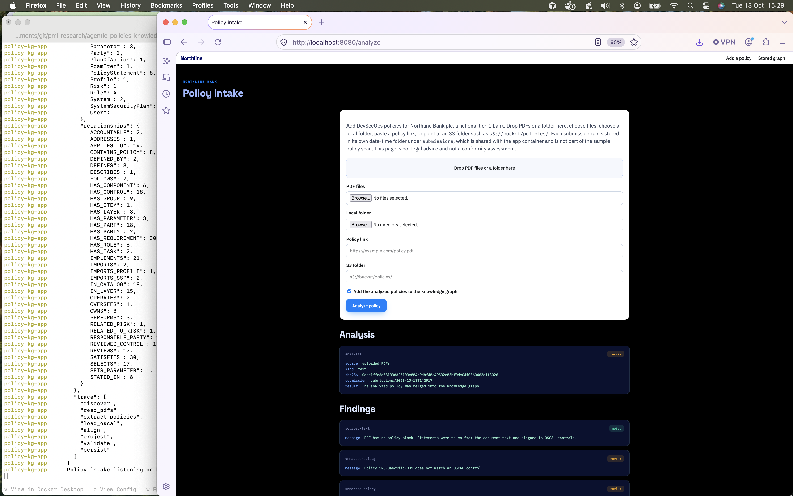

# Policy knowledge graph

LangGraph pipeline that reads DevSecOps policy PDFs, loads [OSCAL](https://pages.nist.gov/OSCAL/) catalogs, profiles, component definitions, system security plans, assessment plans, and plans of action and milestones, and writes a knowledge graph to a local Neo4j container.

The worked example is **Northline Bank plc**, a fictional tier-1 bank with 100,000 employees. It is not a real institution, not legal advice, and not a conformity assessment. Control ids for the EU AI Act follow the Apache-2.0 catalog at [olon-standards/eu-ai-act-oscal](https://github.com/olon-standards/eu-ai-act-oscal). The offline snapshot uses short local restatements. `policy-kg fetch-eu-ai-act` downloads the upstream catalog, the high-risk provider profile, the [SSP template](https://github.com/olon-standards/eu-ai-act-oscal/blob/main/docs/examples/template-system-security-plan.json), the readiness assessment plan, and [SCOPE.md](https://github.com/olon-standards/eu-ai-act-oscal/blob/main/docs/SCOPE.md).

The control lifecycle is stored as eight layers. Each OSCAL model is one layer, merged on uuid or id, and joined to the next layer by an import or a shared uuid. The policy layer is the bank's own statements. See [docs/oscal-layers.md](docs/oscal-layers.md). `policy-kg query layers` lists them.

## Pipeline

```text
discover -> read_pdfs -> extract_policies -> load_oscal -> align -> project -> validate -> persist
```

A run persists to Neo4j only when validation has no error findings.

## Run locally

The app always runs as two containers on the dedicated bridge network `policy-kg-net`: `policy-kg-neo4j` and `policy-kg-app`. They do not join another Compose network. The app container loads the graph after Neo4j is healthy, then serves the policy intake page.

```bash
cd langgragh-sdk-app
docker compose up -d --build --wait
docker compose exec app policy-kg query policies
docker compose exec app policy-kg query gaps
```

Open http://localhost:8080 to add policies. Drop PDFs or a folder on the page, choose files, choose a local folder, paste an http(s) link, or enter an S3 folder such as `s3://bucket/policies/`. A PDF that contains a policy block uses that block. A sourced PDF without a block is split into statements and aligned to the loaded OSCAL catalogs. Leave “Add the analyzed policies to the knowledge graph” checked to merge the result into Neo4j.

### Sample analysis pipeline run

The terminal is the finished pipeline: node and relationship counts, the stage trace through `persist`, then `Policy intake listening`. The browser is http://localhost:8080/analyze after a sourced PDF. The analysis record says the policy was merged, and the findings name the sourced text and any statement that did not match a control.



Each submission run is written to its own date-time folder under `submissions/`. That directory is bind-mounted into the app container at `/app/submissions` and is not committed. The baseline scan of `data/policies/*.pdf` does not read it.

http://localhost:8080/graph shows the policies and the OSCAL ontology stored in Neo4j: organization, catalogs, frameworks, profiles, control groups, controls, and policy statements.

Batch the same ingest from the command line. One command is one submission run:

```bash
docker compose exec app policy-kg batch \
  --from-dir data/incoming \
  --oscal-dir data/oscal \
  --organization data/organization.json \
  --intake-dir submissions

docker compose exec app policy-kg batch \
  --s3-uri s3://bucket/policies/ \
  --oscal-dir data/oscal \
  --organization data/organization.json \
  --intake-dir submissions
```

S3 uses the AWS default credential chain inside the container. Do not put access keys in the repository. A host folder must sit under `./data` or `./submissions` to be visible in the container.

Neo4j Browser is at http://localhost:7474 (`neo4j` / `policy-graph-local`). That password is for this container only. Bolt on the host is `localhost:7687`. Inside the network the app uses `bolt://neo4j:7687`.

`docker compose down` stops both containers and removes `policy-kg-net`. The tests use a separate file, `docker-compose.test.yml`, and a separate network, `policy-kg-test-net`.

## A new policy PDF

Put this block in the PDF. Each field stays on its own line.

```text
POLICY-BLOCK-START
policy_id=POL-NEW-001
title=Short title
owner=Chief Information Security Officer
applies_to=credit-decisioning
oscal_controls=aia-9, ds-cm-1
classification=Internal
statement=One or more short lines joined into the policy statement.
POLICY-BLOCK-END
```

`applies_to` is a comma-separated list of system slugs (`credit-decisioning`, `payments-delivery`). `oscal_controls` may be omitted; the aligner then uses phrase rules and title overlap. Declared ids are the auditable path. A selected control with no policy or no SSP/component implementation fails validation (`uncovered-control`, `unimplemented-control`).

## Tests and deploy

```bash
pytest
```

Pytest starts the disposable Neo4j in `docker-compose.test.yml` on port 7688 unless `NEO4J_URI` is already set. It wipes a database only when the password is `policy-graph-test`.

GitHub Actions:

- `.github/workflows/test.yml` runs pytest against a Neo4j service container.
- `.github/workflows/deploy.yml` publishes `ghcr.io/<owner>/<repo>/policy-kg` on `workflow_dispatch` and on pushes to `main` that touch this app.

`make deploy` is `docker compose up -d --build --wait` for this stack.

## Skills transfer

`skills-transfer/` holds a dated changes log, Claude skills, a Kiro power with the same skills, session memory, and a README that explains how to copy the pack into another Cursor session. The pack includes skills to test and debug a batch run and the interactive app. Start at [`skills-transfer/README.md`](skills-transfer/README.md).

- Claude: copy `skills-transfer/claude/skills/*` to the project's `.claude/skills/`.
- Kiro: import the power folder `skills-transfer/kiro/policy-pipeline`.
